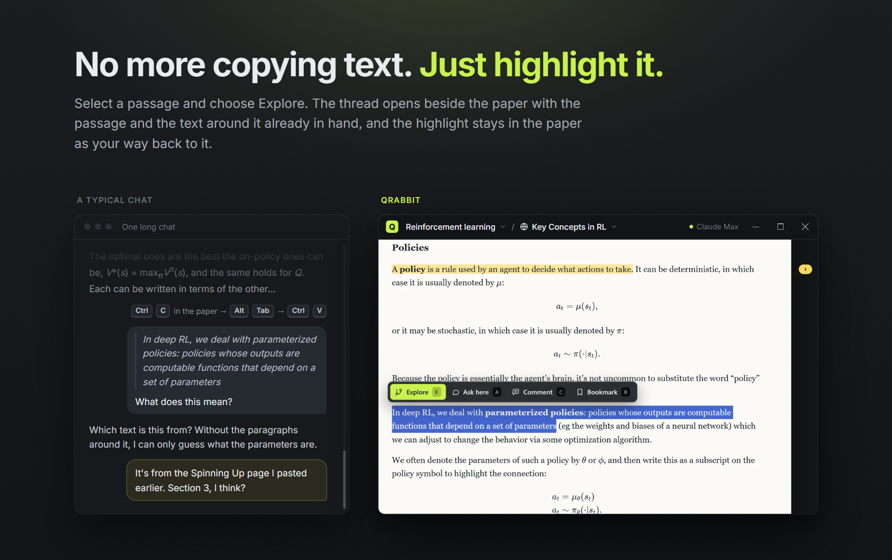
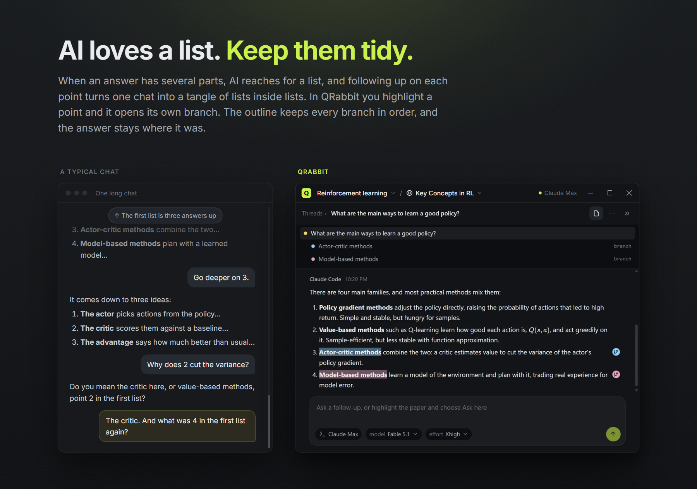
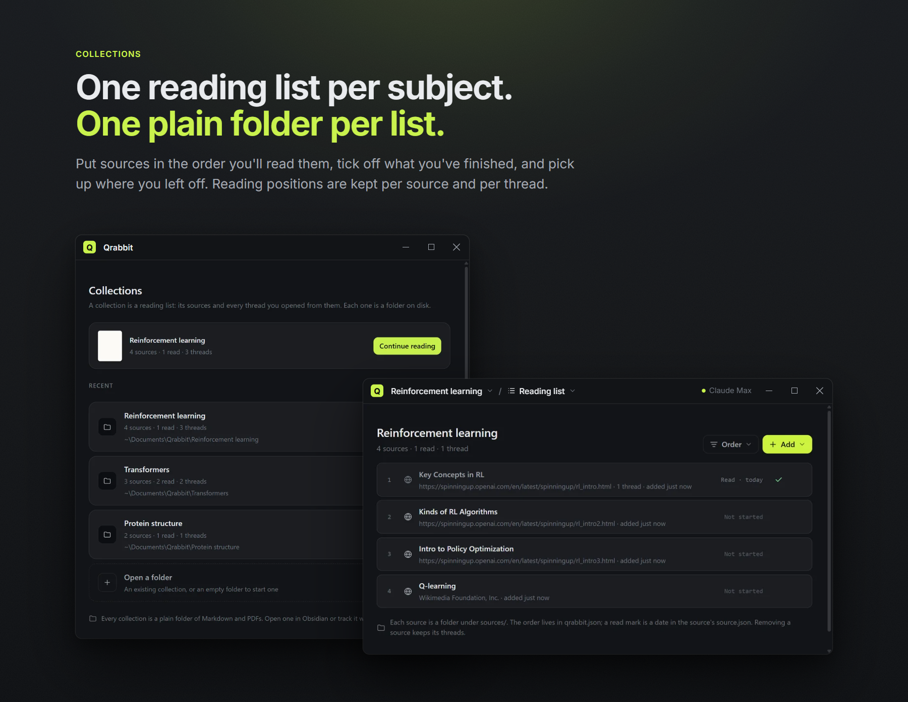

# Qrabbit

Read difficult material with AI. Highlight a passage, explore it in a thread, branch off inside the answer when something else is unclear, and go as deep as you need. The paper stays where you left it, and everything you explored stays attached to the passage it came from.

Qrabbit runs on the coding agent you already pay for. It talks to Claude Code or Codex through the Agent Client Protocol, so turns draw on your Claude or ChatGPT subscription rather than an API key, and the app never sees a credential.

https://github.com/user-attachments/assets/55911246-5bcf-4ba2-ac15-7b373cc4e1fc







## How it works

- **Highlight and explore.** Select any passage in a PDF or article and choose Explore (E). A thread opens beside the paper, anchored to that passage, and the agent answers with the surrounding text and page citations in hand. Ask here (A) adds another passage to the thread you're in.
- **Branch inside answers.** Select part of an answer and Explore it. The branch gets a handoff from the parent conversation, so it starts with context rather than from scratch. When you go back to the parent, what you learned in the branch rides along with your next question. Nothing is closed, resolved or marked done; leaving a branch is just navigation.
- **Marks of your own.** Comments (C) and bookmarks (B) sit in the margin next to thread markers. They're yours; the agent never receives them.
- **Web pages read like papers.** Add a URL and it is fetched once, reduced to its article text and saved as Markdown, so it can be highlighted, explored and read offline. Formulas published as images, MathML or MathJax come back as real LaTeX, code blocks keep their language, and callouts stay callouts.
- **Out of the way.** No sidebar: collections, sources, threads and marks live in header menus. The divider between paper and panel drags, Ctrl+Shift+F hides the paper, and everything has a shortcut (Ctrl+, lists them).

## A collection is a folder

Files are the truth. Open a collection in Obsidian or track it with git whenever you like.

```
my-research/
  qrabbit.json         manifest, with the reading order
  AGENTS.md            instructions any agent reads when its session runs here
  sources/<id>/        source.pdf or source.md (a web page is saved as Markdown with its link),
                       source.json (with a read date once you mark it),
                       text.md (extracted text with <!-- page N --> markers),
                       annotations.json (your bookmarks and comments)
  threads/             one Markdown file per thread; branches nest under their parent's folder
  notes/               the agent may write here
  .qrabbit/            app state; safe to delete. Removed sources wait in .qrabbit/trash/ for a week
```

## The agent

Opening a collection starts one agent process, Claude Code or Codex through its ACP adapter, with the collection as its working directory. Each thread gets its own session, and the model and effort pickers beside the composer come from the agent itself.

The agent is chosen per computer, from the header's agent menu or Settings, because a sign-in belongs to the machine while a collection may sync to others. Switching keeps every thread: the new agent gets a thread's history on its first turn. Model and effort defaults are kept per agent in the collection's manifest.

Sign-in happens in the agent's own flow, started from the header menu: Claude Code's runs in a terminal window, and Codex opens ChatGPT's sign-in page in the browser and keeps the tokens in its own store. API-key sign-in is deliberately not offered. Reads inside the collection and writes under `notes/` are allowed automatically; anything else asks you in the thread panel. Codex runs in its read-only mode, so each file change it wants comes to that same check.

## Running it

Qrabbit is early. Windows installers and Linux packages are on [GitHub Releases](https://github.com/AdrianCryer/qrabbit/releases/latest); macOS is not out yet. The Windows installer is unsigned for now, so Windows asks before running it. On Linux (x64), take the .deb on Debian and Ubuntu and the AppImage elsewhere; on Ubuntu 24.04 and later the AppImage cannot start Chromium's sandbox, which the .deb sets up an AppArmor profile for. You need a Claude Code or ChatGPT (Codex) sign-in on the machine. The agent you pick downloads on first use, about 90 to 150 MB into Qrabbit's data folder, and the Node it runs on comes with the install; nothing else needs installing.

To run it from source you need Node 22 or later and pnpm. On Windows the agents run on that Node rather than on Electron's: a hidden console Node passes a windowless console down to everything the agents start, where Electron, a GUI program, would leave each console program to open a window of its own.

```bash
pnpm install
pnpm desktop:dev
```

If `apps/desktop/node_modules/electron/dist` is missing after install, run `node apps/desktop/node_modules/electron/install.js` once.

Other commands:

```bash
pnpm typecheck                         # every package
pnpm test                              # vitest where a package has tests
pnpm desktop:build                     # build the app into apps/desktop/out
pnpm desktop:pack                      # package it unpacked into apps/desktop/dist, for a local check
pnpm desktop:dist                      # build the installer into apps/desktop/dist
pnpm release <version>                 # set the app's version, commit and tag it (see Releases)
pnpm desktop:drive <work-dir>          # scripted run with screenshots (see .claude/skills/run-desktop)
node tools/dev/drive-agents.mjs <dir>  # switch to Codex and back, checking sign-in, Settings and windows
pnpm spike:acp                         # the original ACP spike against Claude Code
pnpm site:dev                          # the promo site (apps/site), at localhost:4321
pnpm cloud:start                       # the local Supabase stack behind Qrabbit Cloud (needs Docker)
pnpm cloud:test                        # end-to-end sync tests against that stack
```

## Releases

A release is a tag. `pnpm release 0.2.0` sets the desktop app's version, commits and tags `v0.2.0`; `git push --follow-tags` then runs the release workflow (`.github/workflows/release.yml`), which packages the app on each platform's own runner and uploads the artifacts to a draft GitHub Release for the tag. Write the notes on github.com and publish it. Builds cannot cross platforms: the agent adapters pull in their vendor binaries (Codex, the Claude Code CLI) as platform-specific packages at install time. Artifact names carry no version, so the site links each platform's current build through `releases/latest/download/<name>`.

The packaging is `apps/desktop/electron-builder.yml`. The app ships as plain files rather than an asar archive, because the adapters are separate Node programs and Node cannot read inside an archive. The agents themselves are not in the install: each adapter is an npm package that `apps/desktop/src/main/agent-install.ts` downloads the first time the agent is picked, into the app's data folder, with the npm that ships beside the Node the adapters run on. Adding an agent is a registry entry in `packages/shared`, not hundreds of megabytes in every installer. Every build ships that Node, npm included, which `apps/desktop/scripts/fetch-node.mjs` downloads for the build machine's platform and checks against nodejs.org's checksums. In development the adapters are devDependencies and run from there; `QRABBIT_AGENTS_MANAGED=1` makes a dev build download them like a packaged one. The cloud a build talks to comes from its environment: `QRABBIT_CLOUD_URL` and `QRABBIT_CLOUD_PUBLISHABLE_KEY`, as repository variables in Actions or `apps/desktop/.env.production.local` locally (see `.env.example`).

To check a build without an installer, `pnpm desktop:pack` and point the drivers at it: `QRABBIT_APP=apps/desktop/dist/win-unpacked/Qrabbit.exe node tools/dev/drive-agents.mjs <dir>` starts both agents from the packaged layout and checks that the bundled Node hosts them. On Linux the build is `apps/desktop/dist/linux-unpacked/qrabbit`, and `tools/dev/probe-linux.mjs` checks what is Linux's own (the window buttons, the sign-in terminal); `.claude/skills/run-desktop` describes building and driving it from Windows through WSL. Builds are unsigned for now, and macOS is configured but not yet checked.

## Repository

```
apps/desktop/        Electron app (electron-vite, React, PDF.js, KaTeX)
apps/site/           promo site: features, agents, pricing, downloads (Astro, static)
apps/cloud/          Qrabbit Cloud: the Supabase project behind sync and backup (schema, policies, sync functions, tests)
packages/shared/     types, ids, the renderer/main API contract
packages/workspace/  the collection folder format: manifest, sources and web extraction, threads, reader state
packages/acp-client/ generic Agent Client Protocol client: spawn, sign in, model picker, streaming, permissions
packages/cloud-api/  the sync protocol (which paths sync, changes, commits, quota) and the client over Supabase
packages/cloud-sync/ keeps a collection folder in step with the cloud: scan, pull, merge by file format, push
tools/dev/           sample PDF generator, Playwright driver, icon, screenshot staging and probe tools
tools/spike-acp/     step 0: drives the Claude Code ACP adapter from a script
planning/            the plan (plan-v2.md) and the cloud design (plan-cloud.md); earlier notes and prototypes are in the git history
```

## License

Apache-2.0; see [LICENSE](LICENSE). The Qrabbit name and logo are not covered by it.
