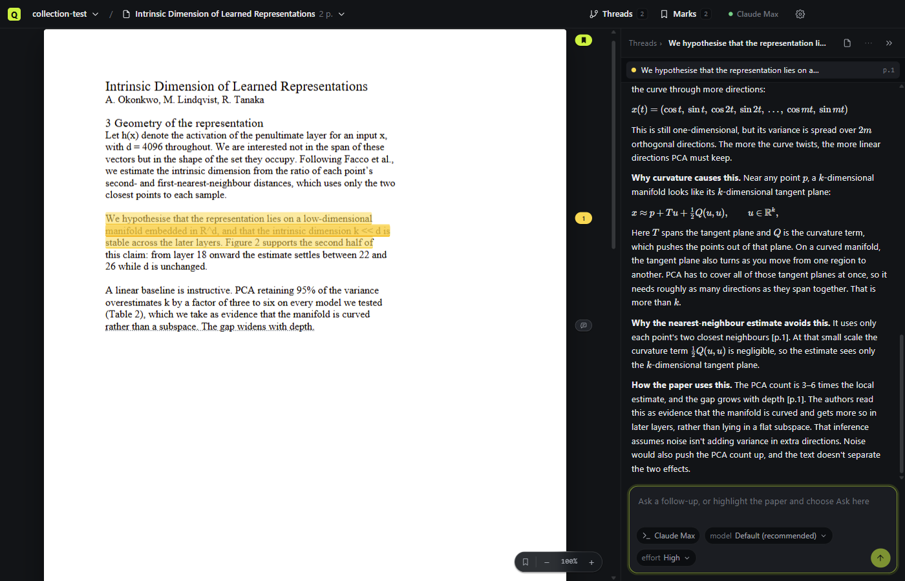
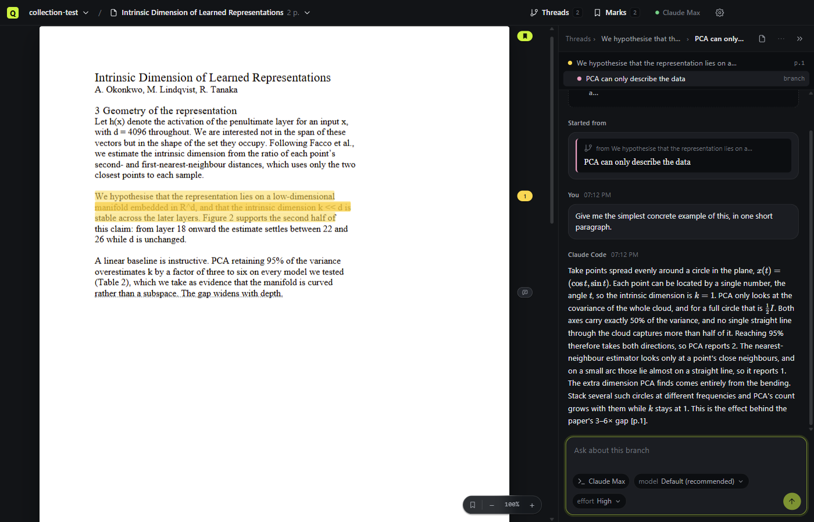
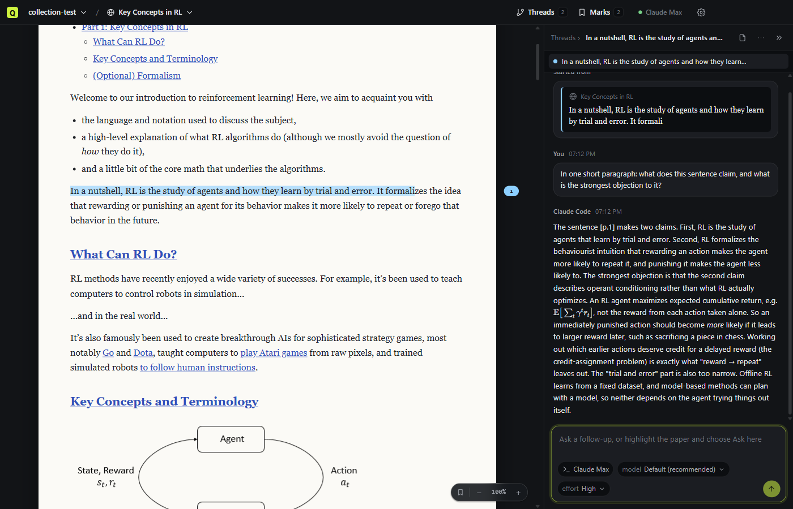
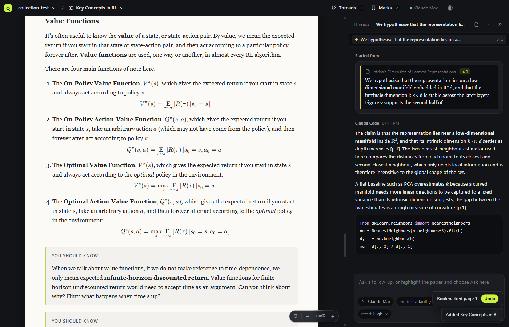

# QRabbit

Read difficult material with AI. Highlight a passage, explore it in a thread, branch off inside the answer when something else is unclear, and go as deep as you need. The paper stays where you left it, and everything you explored stays attached to the passage it came from.

QRabbit runs on the coding agent you already pay for. It talks to Claude Code through the Agent Client Protocol, so turns draw on your Claude subscription rather than an API key, and the app never sees a credential.



## How it works

- **Highlight and explore.** Select any passage in a PDF or article and choose Explore (E). A thread opens beside the paper, anchored to that passage, and the agent answers with the surrounding text and page citations in hand. Ask here (A) adds another passage to the thread you're in.
- **Branch inside answers.** Select part of an answer and Explore it. The branch gets a handoff from the parent conversation, so it starts with context rather than from scratch. When you go back to the parent, what you learned in the branch rides along with your next question. Nothing is closed, resolved or marked done; leaving a branch is just navigation.
- **Marks of your own.** Comments (C) and bookmarks (B) sit in the margin next to thread markers. They're yours; the agent never receives them.
- **Web pages read like papers.** Add a URL and it is fetched once, reduced to its article text and saved as Markdown, so it can be highlighted, explored and read offline. Formulas published as images, MathML or MathJax come back as real LaTeX, code blocks keep their language, and callouts stay callouts.
- **Out of the way.** No sidebar: collections, sources, threads and marks live in header menus. The divider between paper and panel drags, Ctrl+Shift+F hides the paper, and everything has a shortcut (Ctrl+, lists them).







## A collection is a folder

Files are the truth. Open a collection in Obsidian or track it with git whenever you like.

```
my-research/
  qrabbit.json         manifest, with the reading order
  AGENTS.md            instructions any agent reads when its session runs here
  sources/<id>/        source.pdf or source.md (a web page is saved as Markdown with its link),
                       source.json (with a read date once you mark it),
                       text.md (extracted text with <!-- page N --> markers),
                       annotations.json (your bookmarks and comments)
  threads/             one Markdown file per thread; branches nest under their parent's folder
  notes/               the agent may write here
  .qrabbit/            app state; safe to delete. Removed sources wait in .qrabbit/trash/ for a week
```

## The agent

Opening a collection starts one agent process, Claude Code through its ACP adapter, with the collection as its working directory. Each thread gets its own session, and the model and effort pickers beside the composer come from the agent itself.

Sign-in happens in Claude Code's own terminal flow, started from the header menu. Reads inside the collection and writes under `notes/` are allowed automatically; anything else asks you in the thread panel.

## Running it

QRabbit is early and not yet packaged. You need Node 22 or later, pnpm, and a Claude Code sign-in on the machine.

```bash
pnpm install
pnpm desktop:dev
```

If `apps/desktop/node_modules/electron/dist` is missing after install, run `node apps/desktop/node_modules/electron/install.js` once.

Other commands:

```bash
pnpm typecheck                         # every package
pnpm test                              # vitest where a package has tests
pnpm desktop:build                     # build the app into apps/desktop/out
pnpm desktop:drive <work-dir>          # scripted run with screenshots (see .claude/skills/run-desktop)
pnpm spike:acp                         # the original ACP spike against Claude Code
```

## Repository

```
apps/desktop/        Electron app (electron-vite, React, PDF.js, KaTeX)
packages/shared/     types, ids, the renderer/main API contract
packages/workspace/  the collection folder format: manifest, sources and web extraction, threads, reader state
packages/acp-client/ generic Agent Client Protocol client: spawn, sign in, model picker, streaming, permissions
tools/dev/           sample PDF generator, Playwright driver, icon and probe tools
tools/spike-acp/     step 0: drives the Claude Code ACP adapter from a script
planning/            the plan (plan-v2.md), design notes and the clickable prototype
```
